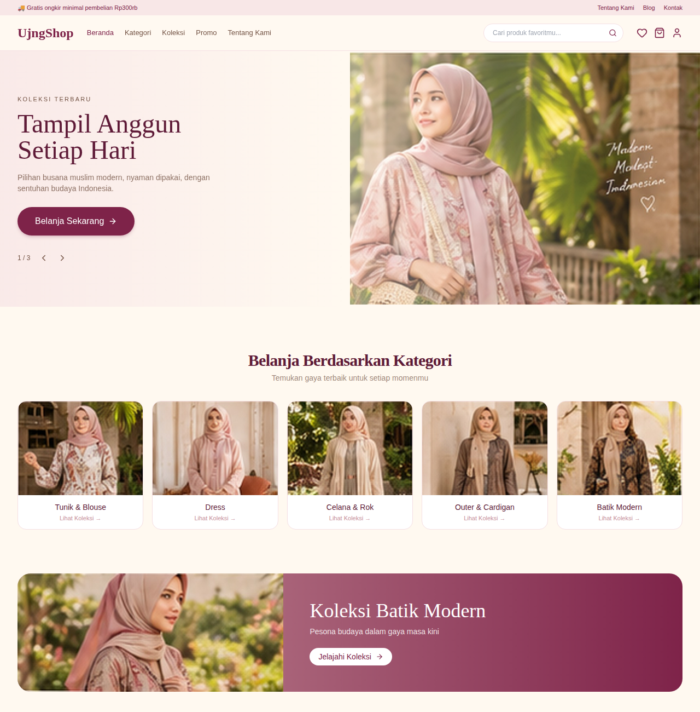

# 🛍️ UjngShop — Indonesian Modest Fashion (Front-End Demo)

Toko online fashion muslim modern, **100% front-end** (tanpa backend) — dibuat sebagai proyek portofolio.
Seluruh data produk bersifat dummy, dan state disimpan di `localStorage`.

<p align="center"></p>

## ✨ Fitur

- 🏠 Beranda: hero slider otomatis, kategori, best seller, banner promo, testimoni, newsletter
- 🔎 Katalog: filter kategori, rentang harga, rating, promo; urutkan; ganti tampilan 2/3 kolom; pencarian
- 👗 Detail produk: pilih warna, ukuran, jumlah; produk terkait
- ❤️ Favorit (wishlist) tersimpan di `localStorage`
- 🛒 Keranjang: ubah jumlah, hapus, voucher (`UJNG10`, `HEMAT20`), gratis ongkir ≥ Rp300.000
- ✅ Checkout demo dengan validasi form + nomor pesanan
- 📱 Responsif (mobile 360px, tablet 768px, desktop) + bottom navigation di mobile
- 📨 Form kontak & newsletter dengan validasi

## 🧰 Tech Stack

React 19 · TypeScript · Vite · React Router (HashRouter) · Tailwind CSS 3 · lucide-react

## 🚀 Menjalankan

```bash
npm install
npm run dev      # http://localhost:3000
npm run build
```

## 🖼️ Catatan Gambar

Gambar di `public/images/` diambil dari mockup desain dan beresolusi rendah.
Ganti dengan foto produk beresolusi tinggi (nama file sama) untuk hasil terbaik.

## 👤 Author

**ujngflsh**
